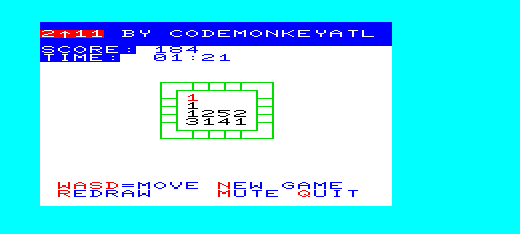
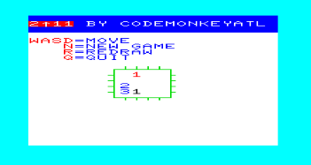
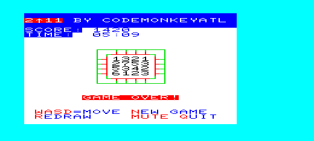

# vic20-2up11

2up11 is a VIC-20 BASIC V2 puzzle game written for an unexpanded VIC-20. It is inspired by the mechanics of 2048, but adapted for the constraints of the VIC-20 and a 4x4 grid. Tiles represent **powers of 2** rather than numeric values, so the board displays PETSCII symbols instead of numbers. Matching tiles combine, new tiles spawn, and the goal is to reach the highest power of 2 you can before the board fills.

This repository contains the current version of the BASIC source and an automated build workflow that generates a `.prg` file whenever a `.bas` file is merged through a pull request.

## features

- written entirely in BASIC V2  
- runs on an unexpanded VIC-20  
- 4x4 grid adapted from 2048-style gameplay  
- Tiles represent powers of 2 and are displayed using PETSCII characters. The visual progression follows the VIC‑20 screen code sequence (1‑9, 0, inverted 1‑9, 0), giving each power a distinct appearance.  
- supports directional movement, tile merging, and score tracking  
- a new random board every run (seeded from the VIC's clock)  
- builds automatically through GitHub Actions using a repo-stored petcat executable  

## how to play
2up11 is a tile merging puzzle game inspired by the mechanics of 2048 progression. The goal is to combine matching tiles to reach the highest power of two you can before the board fills up.

Tiles represent powers of two and are displayed using PETSCII characters. The progression follows the VIC 20 screen code sequence: 1 through 9, then 0, then the inverted 1 through 9, then inverted 0. The character is the last digit of the power: `1` is 2, `2` is 4, `0` is 1024, and an inverted `1` is 2048.

You move tiles with `w` (up), `a` (left), `s` (down) and `d` (right). 
When you move in a direction, all tiles slide as far as they can. 
Matching tiles merge into the next PETSCII character in the progression. 
Tiles that just merged are drawn in blue. 
After each move, a new tile appears in an empty space, drawn in red: a 2 (90% of the time) or a 4.

The game ends when no moves are possible. 
The board must have at least one empty space or at least one adjacent pair of matching tiles. 
If neither condition is true, the game is over. 
The game shows GAME OVER once the board is full and you've tried all four directions without anything moving.

**Wall colors:** the inner wall on the side you move toward turns blue while the move runs. It turns back to green if the tiles moved, or red if nothing could move. A red wall stays red until a move works, so at game over all four inner walls are red.

| Key | Action |
|---|---|
| `w` `a` `s` `d` | move up, left, down, right |
| `n` | new game |
| `r` | redraw the screen |
| `q` | quit |

**Score:** each merge adds the value of the new tile (two 4s make an 8 and score 8), as in 2048. The score shows near the top of the screen. 
Progress is also visible directly on the board through the tile progression.

## screenshots





## compatibility
2up11 runs on an unexpanded VIC 20. No RAM expansion is required.

The game works on real hardware, including VIC 20 units with standard keyboards and video output. 
It also works in VICE using the xvic emulator. 
It runs should run correctly on the MiSTer VIC 20 core and on SD2IEC, Pi1541, and other modern storage devices that support PRG loading, but it has not been tested.

The game is written entirely in BASIC V2 and fits within the memory constraints of an unexpanded machine.

## repository layout

```
src/
  2up11.bas        the game

prgs/
  (.prg files built by the GitHub Action)

docs/
  design.md            how the program works
  todo.md              known issues and ideas
  basic-guidelines.md  how we write BASIC for the unexpanded VIC-20
  cheatsheet.md        petcat tokens, VIC-20 color codes and registers

screenshots/
  images used in this README and the cheatsheet (temp/ holds working captures and is gitignored)

tools/
  petcat, petcat.exe   petcat for Linux (CI) and Windows (local builds)
  c1541, c1541.exe     c1541 for making disk images

buildtools/
  build-and-run.ps1  local build: check, petcat the current .bas, then autostart it in xvic
  check-basic.ps1    lint a .bas file against docs/basic-guidelines.md (warnings only)
  screenshot.ps1     save the running xvic screen to screenshots/temp/ (gitignored)
  keys.ps1           type keys into the running xvic (for testing)
  tasks.vs.json      Visual Studio task (copy to .vs/tasks.vs.json)
  tasks.json         VS Code task (copy to .vscode/tasks.json)

.github/workflows/
  build-prg.yml      builds .prg files when a pull request is merged
```

## building

The `.prg` is generated with `petcat`. The repository includes Linux and Windows versions in `tools/`.

```
petcat -w2 -l 1001 -o prgs/2up11 src/2up11.bas
```

`-l 1001` sets the load address to $1001, the start of BASIC on an unexpanded VIC-20.

### build and run from the IDE

`buildtools/build-and-run.ps1` checks the open `.bas` file with `check-basic.ps1`, builds it into `prgs/` and autostarts it in xvic. The check prints warnings (missing jump targets, lines too long to edit on the VIC, stray spaces, line-number problems) but never stops the build. If xvic is already running with its remote monitor on port 6510, the program is sent to that window; otherwise a new xvic is started with `-remotemonitor`. `petcat.exe` and `xvic.exe` must be on your `PATH`.

The IDE config folders are gitignored, so copy the task file into place once:

- Visual Studio (Open Folder): copy `buildtools/tasks.vs.json` to `.vs/tasks.vs.json`, then Build with a `.bas` file active.
- VS Code: copy `buildtools/tasks.json` to `.vscode/tasks.json`, then run the default build task.

## running

### in VICE

```
xvic -memory none -autostart prgs/2up11
```

or load it from the BASIC prompt:

```
load "2up11",8
run
```

### on real hardware

Copy the PRG to a disk image or transfer it with your preferred method (SD2IEC, Pi1541, etc.). No RAM expansion is needed.

## automatic build

When a pull request that changes any `.bas` file is merged (or a `v*` tag is pushed), the GitHub Action in `.github/workflows/build-prg.yml`:

- runs the repository's `tools/petcat` on each changed `.bas` file
- writes the resulting `.prg` files to `prgs/`
- commits them to `main`, naming the pull request or tag in the commit message

This keeps the PRGs in sync with the BASIC source without installing the full VICE package.

## license

This project is released under the MIT License. See the `LICENSE` file for details.
