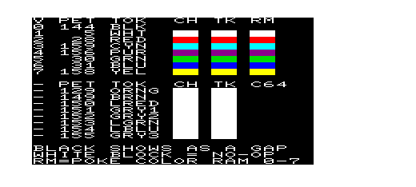
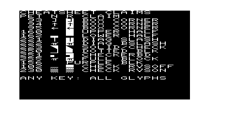
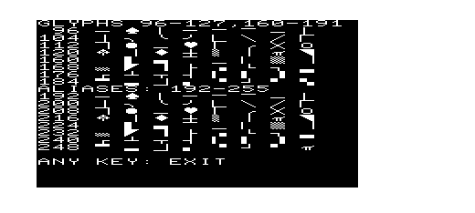
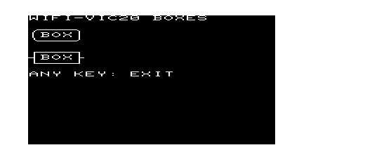

# VIC-20 cheatsheet

## 🎨 petcat color tokens

These are the only `{color}` tokens that work on the VIC-20. They're listed in color-value order (see Color values below).

| PETSCII | petcat token | Color |
|---|---|---|
| 144 | `{blk}` | black |
| 5 | `{wht}` | white |
| 28 | `{red}` | red |
| 159 | `{cyn}` | cyan |
| 156 | `{pur}` | purple |
| 30 | `{grn}` | green |
| 31 | `{blu}` | blue |
| 158 | `{yel}` | yellow |

That's the full VIC-20 set: the VIC-20 has 8 text colors, not 16.

The C64-only codes `{orng}` (129), `{brn}` (149), `{lred}` (150), `{gry1}` (151), `{gry2}` (152), `{lgrn}` (153), `{lblu}` (154) and `{gry3}` (155) are a trap. petcat accepts them without a warning, but the VIC-20 ignores them: the text color stays the same.

Verified in xvic with `src/colortest.bas` in [vic20-ringsort](https://github.com/CodeMonkeyATL/vic20-ringsort). CH is `chr$(code)`, TK is the petcat token, and RM is color RAM poked with values 0–7. Black shows as a gap on the black background, and a white block in the C64 rows means the code had no effect.

## 🖥️ Screen-manipulation control codes

These are the codes you embed in strings (e.g. `print "{clr}"`) and are recognized by VIC-20 BASIC V2.

| PETSCII | petcat token | Action |
|---|---|---|
| 147 | `{clr}` | clear screen |
| 19 | `{home}` | move cursor to top-left |
| 17 | `{down}` | cursor down |
| 29 | `{right}` | cursor right |
| 145 | `{up}` | cursor up |
| 157 | `{left}` | cursor left |
| 18 | `{reverse on}` | enable reverse video |
| 146 | `{reverse off}` | disable reverse video |

These are the full set of VIC-20 cursor/mode controls supported by petcat.

**`tab()` and `pos()` count from the start of the logical line, not the screen row.** The screen editor links up to 4 rows (88 characters) into one logical line whenever printing runs past the right edge, e.g. a `print` of exactly 22 characters without `;`. On a row linked to the one above, the cursor is already past column 22 as far as `tab` knows, so `tab(13)` does nothing. Verified in xvic: `print"{home}{down}{down}{down}"tab(13)"x"` printed `x` at column 0 of a title bar row. To reach a column reliably, use cursor codes (1 byte each) or KERNAL PLOT (`poke781,row:poke782,col:poke783,0:sys65520`, about 29 bytes).

**`{left}` at column 0 wraps to the last column of the row above.** So a spot near the right edge is cheaper to reach from the next row: `{home}{down}{down}{down}{down}` + 9 `{left}` lands on row 3, column 13 (14 bytes, vs 17 with 13 `{right}`). Verified in xvic (2up11's GAME OVER).

## ✍️ Any PETSCII code in a string: `{$xx}`

petcat turns `{$xx}` into the single byte `xx` (hex). So any PETSCII code can go straight into a string literal as plain ASCII source, including graphic glyphs that are hard to type in a PC editor. For example, `print"{$e6}{$e6}{$e6}"` prints three checkerboards.

| Way to print PETSCII 230 | Bytes in the program |
|---|---|
| `"{$e6}"` inside a string | 1 |
| `chr$(230)` | 6 (`chr$` token, parentheses, 3 digits), plus a `;` and quotes to join it to the text around it |
| `b$=chr$(230)` once, then `;b$;` | 10 for the assignment, 7 for the variable, then 4 or more per use |

Many graphic glyphs also have keyboard names: `{CBM-x}` and `{SHIFT-x}` are the glyph you get by typing x with the C= or SHIFT key. For example, `{CBM-+}` = 166 (the checkerboard) and `{SHIFT-*}` = 192 (horizontal line). A name is easier to read, while `{$xx}` works for every code and is exactly the code you mean.

**Rules and traps** (checked against the byte output of this repo's `tools/petcat.exe`):
- **Exactly two lowercase hex digits.** `{$E6}` (uppercase) or `{$5}` (one digit) is an "unknown control code" error, and petcat stops there: the output PRG is truncated to a 2-byte stub. Write `{$05}`, not `{$5}`.
- **Never `{$22}` or `{$00}`.** petcat writes them raw: 34 is the quote, so it ends the string early, and 0 is the end-of-line marker, so it cuts the BASIC line apart. Use `chr$(34)` and `chr$(0)` for these two.
- The color and cursor codes have proper names (see the tables above). Use those instead of `{$xx}`, since the name says what the code does.

## 🔳 Useful graphics PETSCII codes

These are glyphs, not actions: embed them in strings with `{$xx}` (see above), or print them with `chr$(code)`. All of them were verified pixel by pixel in xvic with `src/glyphtest.bas` in [vic20-ringsort](https://github.com/CodeMonkeyATL/vic20-ringsort), in the default uppercase/graphics mode (lowercase mode wasn't tested).

The graphic glyphs are 96–127 and 160–191. The codes 192–254 repeat them: 192–223 = 96–127 and 224–254 = 160–190. 255 is π, the same as 126. A position below is the row (y) or column (x) of the line within the 8×8 cell, counting from 0 at the top or left.

**Blocks.** There is no full-block glyph. Use `{reverse on}` + space, or the reverse of any glyph below for its inverse (e.g. reversed 162 = upper half).

| PETSCII | Glyph |
|---|---|
| 160 | blank (shifted space); reversed it's a full block |
| 161 | ▌ left half |
| 162 | ▄ lower half |
| 190 / 188 | ▘ upper-left / ▝ upper-right quarter |
| 187 / 172 | ▖ lower-left / ▗ lower-right quarter |
| 191 | ▚ upper-left + lower-right quarters (not repeated at 255) |
| 183 / 184 | top 2 / top 3 rows |
| 175 / 185 | bottom 2 / bottom 3 rows |
| 180 / 181 | left 2 / left 3 columns |
| 170 / 182 | right 2 / right 3 columns |
| 169 / 127 | ◤ / ◥ triangle filling the upper-left / upper-right half |

**Checkerboard**

| PETSCII | Glyph |
|---|---|
| 166 | ▒ full-cell checkerboard (230 is the same glyph) |
| 124 | checkerboard, left half only |
| 168 | checkerboard, lower half only |

**Box drawing (lines through the cell center).** These all join at x=4/y=4, so for boxes use 96 for horizontal and 125 for vertical.

| PETSCII | Glyph |
|---|---|
| 96 / 125 | ─ / │ |
| 176 / 174 | ┌ / ┐ |
| 173 / 189 | └ / ┘ |
| 171 / 179 | ├ / ┤ |
| 178 / 177 | ┬ / ┴ |
| 123 | ┼ |

**Cell-edge lines and corners.** These hug the cell border, which makes a box that fills its cells.

| PETSCII | Glyph |
|---|---|
| 163 / 164 | ▔ top edge / ▁ bottom edge |
| 165 / 167 | ▏ left edge / ▕ right edge |
| 111 / 112 | ┌ / ┐ corner (top edge + left or right edge) |
| 108 / 186 | └ / ┘ corner (bottom edge + left or right edge) |

**Lines at other positions**

| PETSCII | Glyph |
|---|---|
| 101, 100, 99, 96, 102, 114 | horizontal line at y = 1, 2, 3, 4, 5, 6 |
| 116, 103, 98, 125, 104, 121 | vertical line at x = 1, 2, 3, 4, 5, 6 |

**Curves and diagonals**

| PETSCII | Glyph |
|---|---|
| 117 / 105 | ╭ / ╮ |
| 106 / 107 | ╰ / ╯ |
| 110 / 109 / 118 | ╱ / ╲ / ╳ (full-cell diagonals) |

**Symbols**

| PETSCII | Glyph |
|---|---|
| 97 / 115 / 120 / 122 | ♠ / ♥ / ♣ / ♦ |
| 113 / 119 | ● / ○ |
| 126 | π (also 222 and 255) |
| 93 / 94 / 95 | ] / ↑ / ← (text characters, not graphics) |

156 isn't a glyph at all: it's the `{pur}` color code.

Page 3 draws the two box styles from meatloaf-prgs `wifi/src/wifi-vic20.bas` with its codes. Rounded: 117 96 105 / 98 … 125 / 106 96 107. Square: 176 96 174 / 179 … 171 / 173 96 189. In the square style the sides are ┤ and ├, so their stubs stick out; use 125 on both sides for a plain square box.

## ⌨️ Keyboard buffer (look-ahead)

The KERNAL scans the keyboard from its interrupt, 60 times a second, even while BASIC is busy. Keys pressed during slow code aren't lost: they wait in a 10-key buffer until `get` (or `input`) takes them.

| Address | Meaning |
|---|---|
| 198 | number of keys waiting (0–10) |
| 631–640 | the waiting keys as PETSCII, oldest first: 631 is the one the next `get` returns |

- **Peek to look ahead without taking keys:** `peek(198)` keys wait at `peek(631)` … `peek(630+peek(198))`. Reading them doesn't remove them; only `get`/`input` does, and then the rest shift down.
- **Flush:** `poke198,0` discards everything waiting (e.g. keys pressed during a splash screen or a long redraw).
- **Wait for a key without a loop:** `wait198,255` returns as soon as a key is waiting, then `get` reads it.
- **Showing the keys on screen:** buffer bytes are PETSCII, screen memory takes screen codes. For letters (65–90), `and63` gives the screen code (1–26); digits and space are the same in both.

Verified in xvic with 2up11's key queue, which pokes the waiting keys under the board while a move is computed: typing `dsawdsaw` during a move showed `SAWDSAW` (the `d` had already been read by `get`). Flush and `wait198,255` are used by RingSort's splash screen.

## 🧠 Color registers

| Address | Function | Range | Notes |
|---|---|---|---|
| 36879 | Screen and border color | 0–255 | Value = background×16 + 8 + border. Bits 0–2 border (0–7), bit 3 normal mode (1; 0 = inverted), bits 4–7 background (0–15). |
| 36878 | Volume / auxiliary color | 0–255 | Bits 0–3 sound volume (0–15), bits 4–7 auxiliary color for multicolor mode. |
| 36874–36877 | Sound voices | 0–255 | Bass, alto, soprano, noise; not colors. See 🔊 Sound below. |
| 38400–38905 | Color RAM (unexpanded) | 0–7 | One per screen cell: the color of the character there. With 8K+ expansion it moves to 37888–38393. |

### 36879 values with a black background

0×16 + 8 + border:

| Value | Background / border |
|---|---|
| 8 | black / black |
| 9 | black / white |
| 10 | black / red |
| 11 | black / cyan |
| 12 | black / purple |
| 13 | black / green |
| 14 | black / blue |
| 15 | black / yellow |

### Color values

| Value | Color |
|---|---|
| 0 | black |
| 1 | white |
| 2 | red |
| 3 | cyan |
| 4 | purple |
| 5 | green |
| 6 | blue |
| 7 | yellow |

## 🔊 Sound

### Sound registers

| Address | Voice | Notes |
|---|---|---|
| 36874 | Bass | Lowest voice. |
| 36875 | Alto | One octave above bass. |
| 36876 | Soprano | One octave above alto. |
| 36877 | Noise | White noise; the value sets its pitch/roughness. |
| 36878 | Volume | Bits 0–3 master volume (0–15) for all voices. Bits 4–7 are the auxiliary color, so `poke36878,15` also sets aux color to 0. |

Voice values:

- `0` turns the voice off.
- `128–255` turns it on; bit 7 is the on switch and bits 0–6 are the pitch. Higher value = higher pitch.
- `1–127` has bit 7 clear, so it's silent.
- A voice keeps sounding until you poke it back to 0. Nothing turns it off for you, so always clean up (including on quit).

### Patterns

There are no envelopes or timers: every sound effect is a BASIC loop poking registers, and the program waits while it runs.

- **Sweep:** `fori=ftoesteps:pokev,i:next:pokev,0` slides one voice from pitch `f` to `e`. Positive step = rising, negative = falling. The step size sets the speed. A fractional step (e.g. `.5`) makes a sweep longer and smoother, because `poke` drops the fraction.
- **Fade:** sweep the volume register (`v=36878`) from 15 down to 0 while a voice holds a note. The sweep ends with `pokev,0`, which leaves volume at 0, so set it back to 15 afterward.
- **Notes with a delay:** poke a pitch, then run a `forj=1to99:next` busy-wait to hold it, then poke the next pitch.
- **Background rumble:** turn the volume down (e.g. 6) and poke random pitches during a long loop as a "working…" sound.
- **Hygiene:** set the volume to 15 at startup, turn each voice off when its sound ends, and set the volume to 0 on quit, so no note is left playing.
- **Sweep subroutine:** one shared routine with its parameters in variables (register, from, to, step) keeps every effect to one line. Calling it with the volume register as the target turns it into a fade.
